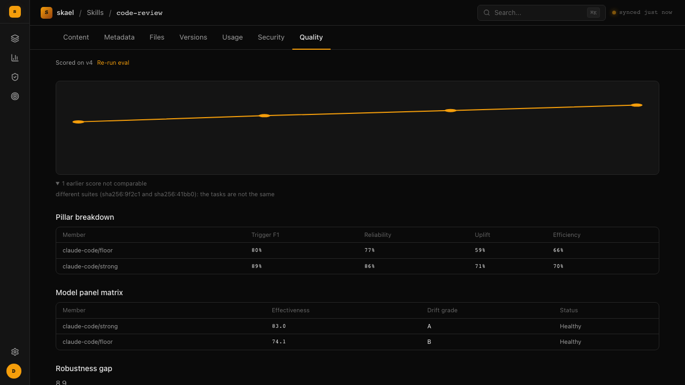

Publishing a skill and scanning it for security problems tells you it's safe to install. It doesn't tell you whether the skill actually helps. Quality scoring answers that: an evaluation, run against a panel of models, measures a skill's effect on task outcomes.

## What a score is

A panel of models attempts a set of real tasks twice: once with the skill installed, once without. The gap between the two is the skill's contribution.

A separate model, the judge, grades each session against the task's expectations. A check is graded without the judge. The share of expectations and checks that pass rolls up into one headline score from 0 to 100.

## From a skill folder to a score

This path takes `examples/code-review` from the repo to a headline on its skill page, on a new instance. Each step names what you see when it works.

### 1. Start the server

From a clone, run `just db` and then `just dev`. Or run `docker compose up -d`. [Self-hosting](/docs/self-hosting) covers both. Open `http://localhost:8080`, enter the claim code from the server log, and create the owner account. Run `skael setup http://localhost:8080 <api-key>` with a key from your account page.

### 2. Add a provider

Open **Settings → Evaluation** and add a provider. Paste one key: OpenRouter, Anthropic or OpenAI each fill an empty panel with default models and a default judge. The server seals the key. It sends the key to a worker only inside a job claim.

### 3. Add a worker

On the same page, click **Add a worker**. Copy the Compose or `docker run` snippet and run it on a machine with Docker. The worker needs only `SKAEL_ENDPOINT` and `SKAEL_API_KEY`.

When the server URL is `localhost`, the snippet uses `host.docker.internal` instead, because `localhost` inside the worker container is the container itself. On Linux, the snippet adds `--add-host=host.docker.internal:host-gateway`.

The worker shows as online on the Evaluation page within a minute.

### 4. Write a suite with skael-evals

Run `skael init` in the repo. It writes the skael skill and the skael-evals skill to `.agents/skills/`, and to `.claude/skills/` when Claude Code is detected. Open a coding agent in the skill folder and ask it to "write evals for this skill". skael-evals tells the agent the layout, the check types and the tier minimums, and it carries a complete suite for `examples/code-review` as an example.

`examples/code-review/evals/` is that suite. Use it as it is to follow this path.

### 5. Check the suite

```bash
skael eval check examples/code-review --tier full
```

The command lists each void eval with its reason, marks each tier ✓ or ✗, and ends with `tier: full`. It exits 1 when a file does not load, when an eval is void, or when the suite is below `--tier`. Fix each ✗ line and run it again.

### 6. Publish

```bash
skael publish examples/code-review
```

Publish lifts `evals/` out of the folder and stores it as the skill's suite. The version is the folder without `evals/`. The publish queues an eval of the new version at the deepest tier the suite reaches, and prints the job id and the tier. A suite below the smoke tier queues no eval. The publish then says why, for example `suite below smoke tier: 3 scorable evals, needs 5`. A publish has one of three outcomes:

- **created**: the skill content changed, so a new version exists.
- **unchanged**: nothing changed.
- **suite updated**: only `evals/` changed. The server stores the suite and queues an eval of the latest version. It creates no version.

### 7. Run the eval and wait

```bash
skael eval run code-review --wait
```

The command queues an eval of the latest version at the deepest tier the suite reaches, prints each job event as the worker posts it, and ends with the headline and the lift. `skael eval run code-review@2 --tier smoke` runs one version at a named tier. The server refuses a tier the suite cannot reach and says why. The command needs an owner or admin key.

A full-tier eval runs each eval twice with the skill, once without it, and six trigger probes. It takes from tens of minutes to more than an hour, by model and by worker concurrency.

### 8. Read the score

The skill page shows the headline, the lift and each eval's results. **Evaluation → Jobs** shows each job's phase, sessions done, failures and cost while it runs, and its events after. A failed session names the provider's error, such as an unknown model id or a rejected key.

### Other routes to a suite

Each of these stores a suite the same way, and each eval runs the same way:

- **Git sync.** A connected repo's skill folder carries `evals/`. A commit that changes only `evals/` stores a new suite and queues one eval, and creates no version. When the suite is below the smoke tier, the connection page lists the folder under "Notes from the last sync" with the reason. A pull request head carries its own suite, and the PR's contest runs it, so a PR changes the exam with the prose in one review.
- **Import.** `skael import` and the web import store a folder's `evals/` as the suite.
- **whetstone.** `whetstone suite gen` drafts a suite from a stored spec, and `whetstone suite push` uploads it. See [whetstone](/docs/whetstone).
- **No suite.** A skill with no suite still gets a score: on `skael eval run` or **Run** on the skill page, the worker derives a suite from the skill's own `SKILL.md`. A derived suite grades the skill against its own claims, so its score cannot release a held version. An instance owner or admin can review the suite's trigger queries in the web UI to mark it authored.

## The suite

The suite lives in the skill folder:

```
code-review/
  SKILL.md
  evals/
    evals.json      tasks, expectations and checks
    triggers.json   prompts the skill must and must not fire on
    files/          input files a task gives the agent
    checks/         scripts a command check runs
```

The layout is Anthropic's skill-creator layout, so a skill moves between the two with no change. Installers never receive `evals/`: a version, `skael pull` and `skael sync` leave it out. The sandbox never receives it either, so the agent under test cannot read the answer key.

### evals.json

| Field | Meaning |
|---|---|
| `id` | A unique integer. |
| `prompt` | The request, typed the way a user types it. |
| `expected_output` | What success looks like. The judge reads it. |
| `files` | Input files, as `evals/files/<name>`. Each is copied to the root of an empty workspace under its base name. |
| `expectations` | Statements the judge marks true or false from the transcript and the files the agent wrote. `assertions` is accepted as a synonym. |
| `checks` | Statements graded without a judge. |

### Checks

| Type | Fields | Passes when |
|---|---|---|
| `file_exists` | `path` | the file exists in the workspace |
| `regex` | `path`, `pattern` | the file's content matches the Go RE2 pattern |
| `json_schema` | `path`, `schema` | the file is JSON that matches the JSON Schema |
| `command` | `script` | `evals/checks/<script>` exits 0 |

Each check has an optional `name`. A check runs in the sandbox after the agent finishes, with the network off, on a copy of the workspace. A command check's script enters the workspace only then, so the agent never reads it. Every file a check reads is copied before any command runs, so a command cannot change what a file check sees.

A check counts as one expectation in the pass rate. The report and each contest loss label it `check: <name>`, so a reader sees which part of a score the judge produced. An eval whose expectations are all checks makes no judge call, so its score does not move when the judge model changes.

A worker older than the release that runs checks never claims a job whose suite has checks: it would ignore the checks. Upgrade the worker if such a job stays queued.

### Tiers

| Tier | Evals that can be scored | Should trigger | Should not trigger | Sessions |
|---|---|---|---|---|
| smoke | 5 | 0 | 0 | each eval once, primary member only, no baseline |
| full | 10 | 3 | 3 | each eval twice and one baseline, primary member only |
| deep | 16 | 8 | 8 | each eval three times on every panel member, one baseline |

An eval is void when it has no expectations and no checks, when a file in `files` is missing, or when a check cannot run. A void eval is never scored, so one void eval can drop a suite below a tier. `skael eval check` names each one.

### Who can change a suite

A suite's score can release a held version, so changing a suite is a change to the skill. Only an owner of the skill or an admin can store one, through `POST /api/eval/suites` or through publish. A publish by someone else stores the version as usual, skips the suite, and says so. An unowned skill takes a suite from anyone who can publish it.

## Choosing the judge and the panel

An owner sets both on the **Evaluation** page. A **provider** is one LLM endpoint and its key: Anthropic, OpenAI, OpenRouter, or any OpenAI-compatible endpoint such as Azure AI Foundry or LiteLLM.

- **The judge** grades every run. It calls the provider's Messages API for an Anthropic provider, and its Chat Completions API for every other type.
- **The panel** runs the tasks. Every member runs in OpenCode, the one harness, inside the sandbox. The first member is the primary member, whose score is the lift. Later members are floor members, which only the `deep` tier runs. Each member chooses its own provider and model.

The model picker lists each provider's tool-capable models from the models.dev catalog, with price and context size, and accepts any typed id, such as an Azure deployment name. A run on the skill page can pin one panel member, or any model through **Other model…**; that run charts as its own series.

`model_panel` records each member's model and provider. A change of either starts a new score trend, because two panels are not the same measurement. The report also records the sandbox image, and the Evaluation page flags a worker whose image differs from the others.

Changing the judge model changes what the expectation half of a score means. Two scores judged by different models are not comparable and are not charted on the same trend line. Checks do not depend on the judge.

`model_panel` also records the harness and its version. A score from OpenCode never shares a trend with one from Claude Code, which ran the panel before 0.20.

## Reading a score

A score isn't a single flat state. Each of these means something different, and the UI shows them differently on purpose:

- **Unscored.** The skill has never been evaluated. This is not the same as scoring zero — a zero says "measured, and it did badly"; unscored says "nobody has measured it yet." Shown as a dash, not a number.
- **Attested vs. verified.** A verified score came from the queue — the worker ran it and posted the report back through the platform. An attested score is a claim without that chain of custody. Only a verified score can release a version the [publish gate](/docs/concepts#publish-gate) is holding for review.
- **Incomplete panel.** One or more models in the panel failed their health check partway through, so the evaluation couldn't be finished properly. This is flagged separately from a low score — a panel that couldn't finish tells you nothing about whether the skill is good.
- **Stale.** The score is for an older version than the one currently being served. The skill has moved on since it was last measured.

## Lift: how much the skill helped

The headline says how good a skill is. **Lift** says how much of that is the skill.

Every evaluation already runs each task twice — once with the skill installed, once without — so lift is the difference: the primary panel member's score with the skill, minus that same member's score without it. Both sides are one agent, one model and one task set, on the same day. A skill detail page reads it as `+27 vs. no skill · 44 without it`.

Two things to know:

- **Not measured is not zero.** A tier that runs no baseline, and a run whose primary panel member produced no score, both leave lift empty. The UI shows a dash and says why. A zero lift means "measured, and it changed nothing" — a different fact entirely.
- **A reused baseline is marked.** Re-running a baseline that has not changed wastes sandbox time, so an eval may copy one from an earlier run (up to 30 days old, same suite, same task, same agent, same model). When it does, the line says `reused baseline`. `whetstone eval --fresh-baseline` runs it again.

Lift is reported, never gated. `QUALITY_FLOOR` reads the headline alone: a low lift can mean an easy suite rather than a weak skill, and nothing can tell those apart automatically.

## Comparing two skills: contests

A score tells you about one skill. It does not settle "my version is better than yours", because two scores measured weeks apart were measured with a different panel, a different agent CLI version and possibly a different suite — and because neither number carries any sense of how much of the gap is noise.

A **contest** answers that question directly. It runs two or more candidate versions against one suite, in one job, on one panel, on the same day, and reports which won each task.

```bash
skael contest payments:deploy platform:deploy
```

A candidate is a published version, written `skill@version`; leaving the version off means the released one. The candidates do not have to be the same skill — two teams rarely agree on a name before they disagree about the content.

### Reading a verdict

The verdict is an exact sign test over the tasks. Each task is a win, a loss or a tie on pass rate; the ties are dropped and the rest is tested against a coin. You get one of three answers, always shown with the split:

- **A winner.** One candidate beat the other by more than chance explains.
- **Too close to call.** The gap is inside the noise. This is a real answer, not a failure to reach one, and it is the common one.
- **Too few tasks decided it.** Fewer than six tasks separated the candidates, so no split could have beaten chance. The contest says so and names the suite, not the skills: *"the suite needs tasks these candidates handle differently."*

That last point is worth sitting with, because it is where most people's intuition is wrong. **A 7–2 split is not a result** — an exact sign test puts it at p = 0.18. At twelve tasks you need 8–1 before the number means anything. If a contest keeps returning "too close to call", the tasks are not discriminating between the candidates, and writing better tasks is the work.

### What a contest costs

A candidate runs only the sessions a verdict reads: every task, at the contest's attempts, with the skill installed. It runs no baseline and no trigger probe, so a contest reports lift as not measured. At the full tier with the default 3 attempts, two candidates run 60 sessions. The worker runs up to `WORKER_CONTEST_PARALLEL` candidates at once.

A contest on a named suite reuses a candidate's run from another contest on the same UTC day, when the archive, suite, tier, attempts and requested panel all match. One candidate always runs fresh, and the worker runs a reused candidate again if its report's grader, panel, agent CLI or engine differs from the fresh one. The contest page names each reused run and the contest it came from.

### A contest changes nothing

It releases no version, holds none, and clears no hold. It records a result you can link to and argue with: the suite it used, who chose the tasks, every task with both pass rates, and the expectations each losing candidate missed.

**Who chose the tasks is always shown**, because in a company the suite is the contested artifact. A suite derived for a contest is derived from *every* candidate, so no candidate's own claims set the bar. A suite authored by someone who owns a candidate still runs — it is disclosed, not refused, because the people who care enough to write a suite are the people competing.

### Is this skill improving?

The **chain** answers that: a sequence of contests between consecutive released versions, each measured on one day with both bundles present. Start one from the quality tab with "Compare with vN".

This is drift-free in a way a trend line cannot be. A link compares two bundles that ran together, so changing the panel later does not invalidate the history — it just means the next link used a different panel, which is fine, because a link is a comparison and not a level.

## Comparing scores over time

`GET /api/skills/{name}/quality/series` (and the trend chart on the skill detail page) show how a skill's score has changed across versions.

The one thing to understand here: two scores are only comparable if they came from the same tasks and the same models. Change the suite, or change which models are in the panel, and the number can move even though the skill itself didn't change. Charting that as one continuous line would be misleading — a jump could look like the skill got better or worse when really the yardstick changed.

So the trend line only plots scores that are genuinely comparable to each other. Everything else is listed separately, with the reason it's not part of the trend (different suite, different panel). A trend line that quietly mixed incomparable scores together would be worse than no trend line at all.



In the example above, four versions were scored the same way, so they form one line. A fifth score exists but was run against a different set of tasks, so it sits under the chart with the reason rather than being plotted.

## How this feeds back into publishing

A version held for review by the publish gate clears automatically once it has a **verified** score at or above `QUALITY_FLOOR` (an operator-configured minimum, default `0` — any verified score with a complete panel clears it). Short of that, it takes an **instance admin** — an account whose role is `owner` or `admin` — running `skael review <name> <version> --approve --reason-kind scan --reason "..."`.

### A score clears one hold reason and only one

A version can be held for two independent reasons: `scan` (a blocking security finding) and `ownership` (published to a name by someone who is not a skill owner of it). They are a set, not a state, and each has to be cleared on its own terms.

**A quality score clears `scan`. It can never clear `ownership`.** No score, however high, releases a version the skill owners have not agreed to. If a score could clear an ownership hold, the whole review path would be decorative — anyone could publish into someone else's namespace and let a passing eval wave it through.

The reverse holds too: a skill owner approving the `ownership` reason does not clear a `scan` finding. Only an instance admin does that. If a namespace owner could, the security gate would only be as strong as the least careful self-managed namespace on the instance.

## Turning a loss into a change

A contest records what each losing candidate missed: the task, the expectations and checks it failed, and the evidence. `whetstone propose` reads that and writes one change to the skill's prose — see [whetstone](/docs/whetstone#whetstone-propose-contest-id).

See [Scanning](/docs/concepts#scanning) for the rest of what the gate does, and [`skael review`](/docs/cli#skael-review-skill-name-version) / the [review queue API](/docs/api#review-queue) for acting on held versions.
