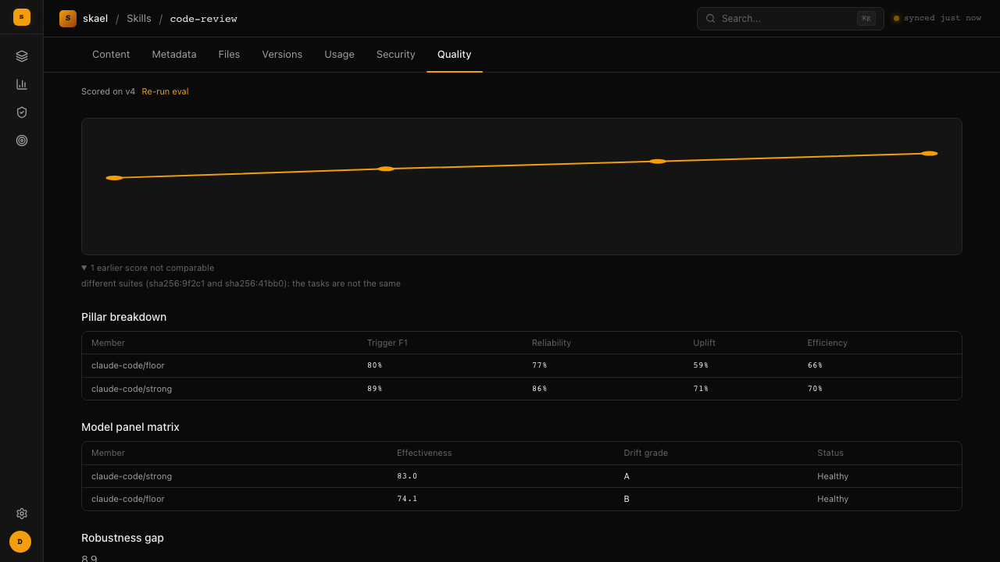

Publishing a skill and scanning it for security problems tells you it's safe to install. It doesn't tell you whether the skill actually helps. Quality scoring is skael's answer to that: a real evaluation, run against a panel of models, that measures a skill's effect on task outcomes.

## What a score is

A panel of models attempts a set of real tasks twice — once with the skill available, once without. The gap between those two runs is the skill's contribution: how much better (or worse) an agent does with it.

A separate model, acting as judge, compares the two transcripts and scores the outcome. Alongside that, a contract checker watches whether the skill did anything it explicitly promised not to — for example, a skill whose spec says "never touch the network" gets flagged if a transcript shows it doing exactly that.

All of that rolls up into a single headline score from 0 to 100.

## What you need to run one

Two things, run separately:

1. **The server.** It queues evaluation jobs and holds the provider keys, but calls no LLM and runs no session — no Docker socket lives there.
2. **A `skael-worker` process, with a sandbox it can run sessions in.** The worker claims jobs from the server, runs the evaluation in a sandboxed session, and posts the score back. By default that sandbox is a Docker daemon the worker can reach; `SANDBOX_DRIVER` selects a Kubernetes cluster or a Northflank sandbox instead, for a worker with no Docker daemon — see [Self-hosting](/docs/self-hosting#choosing-a-sandbox-driver).

Without a worker running, jobs just sit in the queue — nothing gets scored.

### Choosing the judge and the panel

An owner sets both on the **Evaluation** page. A **provider** is one LLM endpoint and its key: Anthropic, OpenAI, OpenRouter, or any OpenAI-compatible endpoint such as Azure AI Foundry or LiteLLM. The server seals each key and sends it to a worker only inside a job claim.

- **The judge** grades every run. It calls the provider's Messages API for an Anthropic provider, and its Chat Completions API for every other type.
- **The panel** runs the tasks. Every member runs in OpenCode, the one harness, inside the sandbox. The first member is the primary member, whose score is the lift. Later members are floor members, which only the `deep` tier runs. Each member chooses its own provider and model.

Paste one key to start: OpenRouter, Anthropic and OpenAI each fill an empty panel with default models. The model picker lists each provider's tool-capable models from the models.dev catalog, with price and context size, and accepts any typed id, such as an Azure deployment name. A run on the skill page can pin one panel member, or any model through **Other model…**; that run charts as its own series.

`model_panel` records each member's model and provider. A change of either starts a new score trend, because two panels are not the same measurement. The report also records the sandbox image, and the Evaluation page flags a worker whose image differs from the others.

Changing the judge model changes what the score means. Two scores judged by different models are not comparable and are not charted on the same trend line. The judge's agreement with human labels (κ) was measured for one judge model; swap the judge and that calibration no longer describes the judge in use.

`model_panel` also records the harness and its version. A score from OpenCode never shares a trend with one from Claude Code, which ran the panel before 0.20.

**Evaluation → Jobs** shows each job's phase, sessions done, failures and cost while it runs, and its events after. A failed session names the provider's error, such as an unknown model id or a rejected key.

## A skill needs a suite first

Before a skill can be scored, it needs a registered evaluation suite — the set of tasks the panel will attempt. Generate one with [whetstone](/docs/whetstone), then register it:

```bash
whetstone suite gen <skill>
whetstone suite push <skill>
```

A skill with no suite gets no score, permanently — there's nothing to run. This is deliberate: scoring against a suite the skill's author never signed off on would measure the wrong thing.

## How long it takes

Roughly 45 to 90 minutes per evaluation, depending on the models and the worker's concurrency. It's running real tasks against real models, twice, plus a judge pass — not a quick lint.

## Reading a score

A score isn't a single flat state. Each of these means something different, and the UI shows them differently on purpose:

- **Unscored.** The skill has never been evaluated. This is not the same as scoring zero — a zero says "measured, and it did badly"; unscored says "nobody has measured it yet." Shown as a dash, not a number.
- **Attested vs. verified.** A verified score came from the queue — the worker ran it and posted the report back through the platform. An attested score is a claim without that chain of custody. Only a verified score can release a version the [publish gate](/docs/concepts#publish-gate) is holding for review.
- **Incomplete panel.** One or more models in the panel failed their health check partway through, so the evaluation couldn't be finished properly. This is flagged separately from a low score — a panel that couldn't finish tells you nothing about whether the skill is good.
- **Stale.** The score is for an older version than the one currently being served. The skill has moved on since it was last measured.

## Lift: how much the skill helped

The headline says how good a skill is. **Lift** says how much of that is the skill.

Every evaluation already runs each task twice — once with the skill installed, once without — so lift is the difference: the primary panel member's score with the skill, minus that same member's score without it. Both sides are one agent, one model and one task set, on the same day. A skill detail page reads it as `+27 vs. no skill · 44 without it`.

Two things to know:

- **Not measured is not zero.** A tier that runs no baseline, and a run whose primary panel member produced no score, both leave lift empty. The UI shows a dash and says why. A zero lift means "measured, and it changed nothing" — a different fact entirely.
- **A reused baseline is marked.** Re-running a baseline that has not changed wastes sandbox time, so an eval may copy one from an earlier run (up to 30 days old, same suite, same task, same agent, same model). When it does, the line says `reused baseline`. `whetstone eval --fresh-baseline` runs it again.

Lift is reported, never gated. `QUALITY_FLOOR` reads the headline alone: a low lift can mean an easy suite rather than a weak skill, and nothing can tell those apart automatically.

## Comparing two skills: contests

A score tells you about one skill. It does not settle "my version is better than yours", because two scores measured weeks apart were measured with a different panel, a different agent CLI version and possibly a different suite — and because neither number carries any sense of how much of the gap is noise.

A **contest** answers that question directly. It runs two or more candidate versions against one suite, in one job, on one panel, on the same day, and reports which won each task.

```bash
skael contest payments:deploy platform:deploy
```

A candidate is a published version, written `skill@version`; leaving the version off means the released one. The candidates do not have to be the same skill — two teams rarely agree on a name before they disagree about the content.

### Reading a verdict

The verdict is an exact sign test over the tasks. Each task is a win, a loss or a tie on pass rate; the ties are dropped and the rest is tested against a coin. You get one of three answers, always shown with the split:

- **A winner.** One candidate beat the other by more than chance explains.
- **Too close to call.** The gap is inside the noise. This is a real answer, not a failure to reach one, and it is the common one.
- **Too few tasks decided it.** Fewer than six tasks separated the candidates, so no split could have beaten chance. The contest says so and names the suite, not the skills: *"the suite needs tasks these candidates handle differently."*

That last point is worth sitting with, because it is where most people's intuition is wrong. **A 7–2 split is not a result** — an exact sign test puts it at p = 0.18. At twelve tasks you need 8–1 before the number means anything. If a contest keeps returning "too close to call", the tasks are not discriminating between the candidates, and writing better tasks is the work.

### What a contest costs

A candidate runs only the sessions a verdict reads: every task, at the contest's attempts, with the skill installed. It runs no baseline and no trigger probe, so a contest reports lift as not measured. At the full tier with the default 3 attempts, two candidates run 60 sessions. The worker runs up to `WORKER_CONTEST_PARALLEL` candidates at once.

A contest on a named suite reuses a candidate's run from another contest on the same UTC day, when the archive, suite, tier, attempts and requested panel all match. One candidate always runs fresh, and the worker runs a reused candidate again if its report's grader, panel, agent CLI or engine differs from the fresh one. The contest page names each reused run and the contest it came from.

### A contest changes nothing

It releases no version, holds none, and clears no hold. It records a result you can link to and argue with: the suite it used, who chose the tasks, every task with both pass rates, and the expectations each losing candidate missed.

**Who chose the tasks is always shown**, because in a company the suite is the contested artifact. A suite derived for a contest is derived from *every* candidate, so no candidate's own claims set the bar. A suite authored by someone who owns a candidate still runs — it is disclosed, not refused, because the people who care enough to write a suite are the people competing.

### Is this skill improving?

The **chain** answers that: a sequence of contests between consecutive released versions, each measured on one day with both bundles present. Start one from the quality tab with "Compare with vN".

This is drift-free in a way a trend line cannot be. A link compares two bundles that ran together, so changing the panel later does not invalidate the history — it just means the next link used a different panel, which is fine, because a link is a comparison and not a level.

## Comparing scores over time

`GET /api/skills/{name}/quality/series` (and the trend chart on the skill detail page) show how a skill's score has changed across versions.

The one thing to understand here: two scores are only comparable if they came from the same tasks and the same models. Change the suite, or change which models are in the panel, and the number can move even though the skill itself didn't change. Charting that as one continuous line would be misleading — a jump could look like the skill got better or worse when really the yardstick changed.

So the trend line only plots scores that are genuinely comparable to each other. Everything else is listed separately, with the reason it's not part of the trend (different suite, different panel). A trend line that quietly mixed incomparable scores together would be worse than no trend line at all.



In the example above, four versions were scored the same way, so they form one line. A fifth score exists but was run against a different set of tasks, so it sits under the chart with the reason rather than being plotted.

## How this feeds back into publishing

A version held for review by the publish gate clears automatically once it has a **verified** score at or above `QUALITY_FLOOR` (an operator-configured minimum, default `0` — any verified score with a complete panel and no contract violations clears it). Short of that, it takes an **instance admin** — an account whose role is `owner` or `admin` — running `skael review <name> <version> --approve --reason-kind scan --reason "..."`.

### A score clears one hold reason and only one

A version can be held for two independent reasons: `scan` (a blocking security finding) and `ownership` (published to a name by someone who is not a skill owner of it). They are a set, not a state, and each has to be cleared on its own terms.

**A quality score clears `scan`. It can never clear `ownership`.** No score, however high, releases a version the skill owners have not agreed to. If a score could clear an ownership hold, the whole review path would be decorative — anyone could publish into someone else's namespace and let a passing eval wave it through.

The reverse holds too: a skill owner approving the `ownership` reason does not clear a `scan` finding. Only an instance admin does that. If a namespace owner could, the security gate would only be as strong as the least careful self-managed namespace on the instance.

## Turning a loss into a change

A contest records what each losing candidate missed: the task, the expectations it failed, and the grader's evidence. `whetstone propose` reads that and writes one change to the skill's prose — see [whetstone](/docs/whetstone#whetstone-propose-contest-id).

See [Scanning](/docs/concepts#scanning) for the rest of what the gate does, and [`skael review`](/docs/cli#skael-review-skill-name-version) / the [review queue API](/docs/api#review-queue) for acting on held versions.
